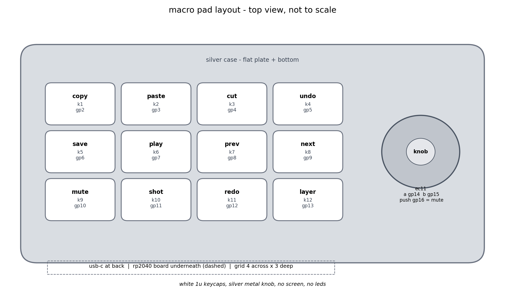
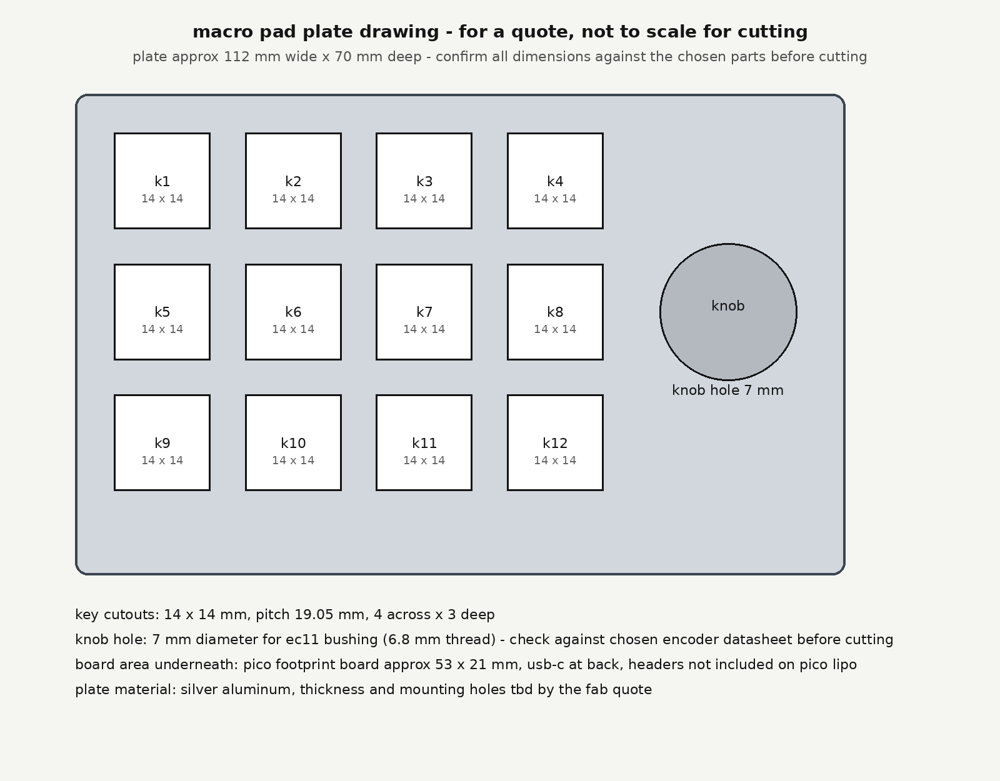

# macro pad

a small macro pad i designed for week 5 freestyle. looks only, it is a
display model, it just has to look good on a desk.

## the idea

i wanted to make something clean that looks good on my desk every day.

so i started designing a macro pad with 12 keys and a scroll wheel on
the side. no screen, no rgb, no wiring, just something clean that looks
good. the look is minimal black and silver.

## what i am building

* 12 keys arranged in a 3x4 grid
* a silver metal mouse scroll wheel in a slot on the right edge, about
  half of it sticking out past the edge, like a mouse wheel
* black keycaps with little grey line icons instead of words
* a silver aluminum plate
* no board, no pcb, no wiring, no firmware, it does not work as a
  keyboard

the keycaps are relegendable, i print the line icons and slide them
under the clear tops. the switches just clip into the plate and hold
the keycaps, no soldering. the wheel is a real 25 mm mouse wheel, the
little encoder behind it only holds its axle, it is not wired to
anything.

## the hardware

the plate is custom cut aluminum, 112 by 70 mm, from md cnc. the
switches are gateron milky pro yellow, they clip into the plate and
hold the keycaps. the wheel is a metal mouse scroll wheel, about 25 mm,
for a logitech g102/g304/g305, and the encoder under it is a ttc 11 mm
mouse wheel encoder, mount only.

here are some of the main dimensions:

component	dimensions
plate	112 x 70 mm
key layout	3 x 4
key spacing	19.05 mm
key cutouts	14 x 14 mm
wheel slot	25 mm long plus clearance, width is the wheel thickness
plus about 1 mm, measure the wheel with calipers on arrival first

the dxf still has the old 7 mm round knob hole in it, the slot goes in
once the wheel is measured.

## the design files

everything is organized in the repository so the design can be reviewed
and worked on separately.

* plate/ contains the plate dxf
* images/ contains design and plate images
* cart-screenshots/ contains parts and quote screenshots

the pcb/ and firmware/ files still in this repo are from the earlier
functional plan and are not part of this build. the gerbers were not
plotted in kicad, they were generated in python, do not order from
them. there are also pin mappings, a netlist, and a draft bill of
materials from that earlier plan, also not part of this build.

## parts and costs

tier 1, total $28.77 at regular prices, verified live november 8. cap
is $33, headroom $4.23. all five lines ship free.

part	price
md cnc custom plate, aluminum, 112x70	$7.15
gateron milky pro yellow switches, 2x 10 pack	$7.22
metal mouse scroll wheel, silver, 25mm	$4.21
ttc mouse wheel encoder, 11mm	$1.61
black relegendable keycaps, 12 pack	$8.58

the plate price is quote-based, $7.15 is the lowest listed tier,
unconfirmed until md cnc quotes the dxf. the full breakdown is in
BOM-draft.md.

## current progress

this is still a design project, not a finished physical build. the
plate dxf, the look, and the parts list are in the repository.

there are a few things i still need to check before ordering anything:

* measure the wheel thickness with calipers on arrival, then cut the
  slot in the plate dxf
* get the md cnc quote from the drawing
* check the black caps stock again, only 1 left at that listing
* finalize the plate thickness, mounting holes, and corner radius

## what is next

the next step is getting the plate cut, then putting it together and
seeing how it looks on a desk.

## a little context

this was made for half life week 5 freestyle, as part of weeks 5 and 10.

it is a display model, not a working keyboard. the shape, spacing, and
finish are the whole point.

more updates once there is an actual macro pad on my desk.
